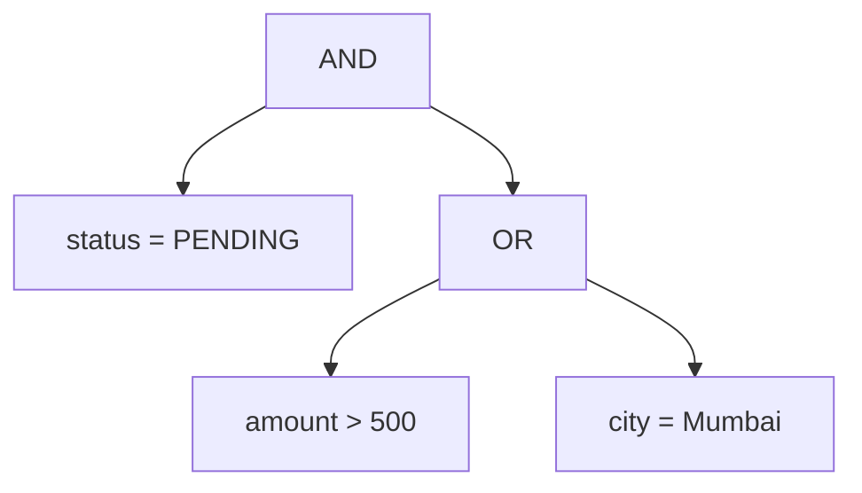

# Sync Engine

**Selective change notifications in C++, designed around low-latency matching and client communication.**

[Repository](https://github.com/TEJASJINDAL16/sync_engine)

Sync Engine addresses a simple question: **when a database row changes, which connected clients actually need to know?**

Each client subscribes to a filter describing the rows it cares about. The engine checks INSERT, DELETE, and UPDATE events against those filters and identifies the affected subscriptions. The service architecture combines expression-tree evaluation, indexed subscription lookup, concurrent event processing, and TCP communication to keep the path from a change to a relevant notification short.

This document explains the problem, matching rules, service design, and performance goals.

## The problem

Applications often display a local view of server-side data. An order dashboard may show only pending orders, a monitoring panel may show only high-severity alerts, and an inventory screen may show only products below a stock threshold.

Different clients therefore care about different parts of the same dataset.

| Client | Saved filter |
| --- | --- |
| A | `status = PENDING` |
| B | `amount > 500` |
| C | `city = Mumbai` |
| D | `status = PENDING AND (amount > 500 OR city = Mumbai)` |

When an order changes, broadcasting the event to every client creates unnecessary messages and refresh requests. Polling introduces repeated requests and a delay between a change and its discovery.

Checking every filter for every event is straightforward, but the matching cost grows with the number of subscriptions. Under load, that extra work can increase queueing and delay relevant notifications.

Sync Engine targets **selective, event-driven notification**: find the interested clients, verify their complete filters, and notify them without involving unrelated clients.

## The solution

The design has two layers:

1. **Matching engine:** represent client filters as trees, evaluate rows, and determine affected subscription IDs.
2. **Notification service:** manage client subscriptions and connections, process events concurrently, and deliver notifications.

The matching engine provides the decision. The service provides the communication and execution model around that decision.

A notification means that a client's saved view may need refreshing. The application can then fetch the relevant data or update its local view. Selecting a recipient does not, by itself, transfer or reconcile the complete dataset.

## Filters as expression trees

A subscription is a row-level condition built from three node types:

| Node | Meaning |
| --- | --- |
| COND | Compare one column with a constant |
| AND | Match only when every child matches |
| OR | Match when at least one child matches |

For example:

```text
status = PENDING AND (amount > 500 OR city = Mumbai)
```

Its structure is:



A recursive evaluator walks this tree:

- A condition looks up the column, checks its type, and applies its comparison.
- AND stops as soon as one child is false.
- OR stops as soon as one child is true.

This short-circuit behavior avoids visiting branches whose result cannot change the final answer.

### Comparison rules

The filter operators are `=`, `<`, `>`, `<=`, and `>=`.

- Integers use numeric comparison: `100 > 20`.
- Strings use case-sensitive lexicographic comparison.
- A missing column makes its condition false.
- Different value types make their condition false, including for equality.
- Column names are case-sensitive.

The text input format treats signed digit-only tokens as integers and other tokens as strings. Values in this format are single tokens, without spaces. The same type interpretation must be used by both the indexes and the tree evaluator.

## How database changes affect subscriptions

Let `matches(filter, row)` mean that the complete expression tree evaluates to true.

| Event | Notification rule |
| --- | --- |
| INSERT | Notify when the new row matches |
| DELETE | Notify when the removed row matches |
| UPDATE | Notify when the old row **or** the new row matches |

UPDATE requires both snapshots because a row can enter, leave, or remain inside a client's result set.

| Old row matches | New row matches | Notify? | Reason |
| --- | --- | --- | --- |
| No | No | No | The row is outside the subscribed view |
| No | Yes | Yes | The row enters the view |
| Yes | No | Yes | The row leaves the view |
| Yes | Yes | Yes | Values in a visible row may have changed |

For example, a client subscribes to `status = PENDING`. An order changes from PENDING to SHIPPED. The new row no longer matches, but the client still needs a notification so it can remove the order from its pending list.

The event supplies the complete affected row, or complete before/after rows for an UPDATE. A partial patch alone is insufficient to evaluate a filter that references unchanged columns.

Each affected subscription appears once in an event's result, even if it matches several conditions or both UPDATE snapshots. The row-matching rule also applies to identical before/after snapshots; an application can suppress verified no-op writes before submitting events if that behavior fits its requirements.

## Indexed subscription lookup

### Why a full scan costs more as subscriptions grow

Let:

- `S` be the number of subscriptions.
- `T` be the maximum number of nodes in a filter.
- `W` be the number of write events.

Ignoring row-lookup and value-comparison costs, evaluating every subscription costs up to `O(S × T)` per row snapshot, or `O(W × S × T)` across the events. UPDATE adds a second snapshot.

Indexing reduces the number of complete filter trees that need evaluation when conditions are selective.

### Equality lookup

An equality index groups conditions by:

```text
(column, value type, constant value) → matching condition owners
```

For example, the key `(status, string, PENDING)` identifies subscriptions containing `status = PENDING`.

A hash lookup finds that bucket without checking every equality condition. Expected lookup cost is constant with respect to the number of keys, plus the cost of reading the matching entries. Large buckets still require work.

### Range lookup

Ordered indexes group thresholds by column, value type, and comparison operator.

Suppose a row contains `amount = 800`. For conditions written as `amount > threshold`, matching thresholds are those below 800. An ordered search finds the boundary, after which the matching entries can be collected.

The direction matters:

| Condition form | Thresholds matching row value `x` |
| --- | --- |
| `column > threshold` | `threshold < x` |
| `column >= threshold` | `threshold <= x` |
| `column < threshold` | `threshold > x` |
| `column <= threshold` | `threshold >= x` |

For a balanced ordered index or sorted threshold array, boundary search costs `O(log K)`, where `K` is the number of threshold entries in that index. Collecting `R` matches adds `O(R)`; finding a boundary does not make enumerating its results free.

### Candidate selection and full verification

Index hits produce **candidate subscriptions**, not final notifications.

A safe matching procedure is:

1. Look up satisfied leaf conditions for every present column in the row.
2. Collect and deduplicate the subscriptions owning those conditions.
3. Evaluate each candidate's complete expression tree.
4. Keep only subscriptions whose full tree matches.
5. For UPDATE, combine results from both row snapshots and remove duplicates.

A subscription containing `status = PENDING AND amount > 500` can become a candidate through its status condition and still fail its amount condition. Complete evaluation preserves correctness.

For this filter model, every matching tree has at least one true condition leaf. Collecting owners of all satisfied leaves therefore gives a conservative candidate set: extra candidates are acceptable, but missing a real match is not.

Candidate selection uses the complete old and new rows, rather than only the changed columns. A filter can match through a column whose value did not change.

This indexing approach trades extra memory and subscription-maintenance work for less event-processing work. If nearly every subscription is a candidate, its benefit shrinks and a full scan may be competitive.

## Service architecture

| Component | Responsibility |
| --- | --- |
| TCP session layer | Receive client requests and deliver framed responses and notifications |
| Subscription registry | Associate clients and subscription IDs with filter trees and indexes |
| Event intake | Accept row-change events and assign their processing sequence |
| Bounded work queue | Hold events awaiting worker execution |
| Worker pool | Select candidates and evaluate complete filters |
| Ordered dispatcher | Release matching results in the required order and manage client output queues |

A client registers a filter and receives a subscription ID. Incoming changes are matched against a consistent subscription view. Matching subscription IDs are mapped to client sessions, and the dispatcher sends the corresponding notifications.

Registration, removal, and event acceptance need a defined order. The subscription view captured for an accepted event determines which filters participate in its evaluation.

## Concurrency and shared state

Concurrency allows separate events to make progress across worker threads. It also introduces shared-state and ordering questions.

### Worker pool

A fixed worker pool avoids creating a thread for every event. Its size is a tuning choice: more workers can improve throughput, but they can also increase scheduling overhead and contention.

The bounded queue prevents unlimited accumulation when incoming work exceeds processing capacity. At capacity, intake needs explicit backpressure or rejection behavior rather than silently growing memory use.

### Subscription access

Workers need a consistent view of the filters and indexes while other clients register or remove subscriptions.

An immutable registry snapshot provides that view:

- An accepted event retains a shared reference to its registry snapshot.
- Registry changes publish a new snapshot.
- Workers read their retained snapshot without seeing partially updated indexes.
- Older snapshots remain alive while events still reference them.

A reader-writer lock is another valid design, with different costs for reading, writing, and contention. The important property is that a filter and its index entries stay consistent for the entire evaluation.

Snapshot creation also has a cost. Frequent subscription changes can make publication and retained snapshots significant contributors to CPU and memory usage.

### Notification order

Worker completion order can differ from event acceptance order.

The ordering contract uses the accepted event sequence. A dispatcher releases results in that order, including completion markers for events with no matching clients. Per-client output queues preserve the notification order within a live connection.

An earlier slow event can delay later results under this contract. Queueing and dispatch measurements make that tradeoff visible.

## TCP communication

TCP provides a reliable, ordered byte stream within a live connection. The protocol still needs message boundaries because one socket read does not necessarily equal one application message.

The service design uses framed messages, such as a length prefix followed by a payload.

The message model covers:

- Subscription registration and its acknowledgement.
- Subscription removal and its acknowledgement.
- Change-event submission from an event producer.
- Notifications carrying an event sequence and subscription identity.
- Errors for invalid requests or filters.

Networking behavior needs to account for partial reads, partial writes, connection closure, and bounded outgoing queues. A slow client should not hold a global registry lock or block matching work for unrelated clients.

TCP ordering applies within a connection. Durable delivery across disconnects requires a separate acknowledgement and replay contract; the live notification path alone does not imply exactly-once delivery.

## Low-latency focus

The latency target is the time between accepting a change and delivering its relevant notification.

Several distinct costs contribute to that path:

| Stage | Source of delay | Design focus |
| --- | --- | --- |
| Queueing | Events wait for available workers | Bounded queues and appropriate worker count |
| Candidate lookup | Index search and result enumeration | Selective equality and range lookups |
| Filter evaluation | Tree traversal, lookups, and comparisons | Short-circuit evaluation and avoiding unnecessary copies |
| Synchronization | Lock contention or registry publication | Consistent read views and limited shared mutation |
| Dispatch | Ordering dependencies and client queues | Explicit sequencing and independent client output |
| Transport | Socket buffering, network transit, and client reads | Framing, handling partial I/O, and backpressure |

Indexing reduces application-side selection work. It does not reduce physical network propagation delay. Its end-to-end value depends on how much selection and related queueing contribute to total latency.

The design targets low processing overhead and predictable behavior under load. No microsecond or nanosecond performance level is implied without a reproducible measurement.

## Performance evaluation

Useful measurements include:

- **Throughput:** events processed per second under a stated workload.
- **Median, p95, and p99 latency:** typical behavior and slower responses.
- **Candidate ratio:** subscriptions evaluated after indexing divided by all subscriptions.
- **Queue depth and waiting time:** whether load is building up before evaluation.
- **Matching versus delivery time:** whether CPU work or output handling dominates.
- **Memory usage:** filter trees, index entries, queued events, and retained registry snapshots.
- **Scaling across worker counts:** gains or regressions from concurrency.

Compare full-scan and indexed evaluation using identical inputs. Include workloads with selective filters, broad OR conditions, repeated values, range-heavy predicates, and different UPDATE match combinations.

Record hardware, compiler settings, dataset size, client count, and offered event rate. For latency across different machines, use synchronized clocks or a suitable round-trip measurement; unrelated local clocks cannot establish accurate one-way latency.

Correctness comes first: indexed and concurrent execution should agree with a simple reference evaluator for the same event and subscription view.

## Example

Consider these subscriptions:

| ID | Filter |
| --- | --- |
| 1 | `status = PENDING AND (amount > 500 OR city = Mumbai)` |
| 2 | `amount > 500` |
| 3 | `city = Mumbai` |

| Change | Matching subscriptions | Explanation |
| --- | --- | --- |
| Insert PENDING, 800, Pune | 1, 2 | Both match through the amount condition |
| Update that row to SHIPPED, 800, Pune | 1, 2 | Subscription 1 matches the old row; subscription 2 matches both |
| Delete SHIPPED, 100, Mumbai | 3 | The deleted row belongs to the Mumbai view |

### Run the expression evaluator

Use a C++17 compiler:

```bash
git clone https://github.com/TEJASJINDAL16/sync_engine.git
cd sync_engine
g++ -std=c++17 -O2 engine.cpp -o sync_engine
./sync_engine < input.txt
```

The evaluator reads subscription trees and row-change events from standard input and prints the affected subscription IDs for each event.

- The first line contains the number of subscriptions and events.
- Each subscription starts with its node count.
- Node IDs follow line order, starting at 1; node 1 is the root.
- A node is written as `COND column operator value`, `AND k child_ids...`, or `OR k child_ids...`.
- Each row starts with its column count, followed by column/value pairs.
- INSERT and DELETE provide one row; UPDATE provides the old row followed by the new row.
- Output IDs are ascending, with `-1` when no subscription matches.

Save this as `input.txt`:

```text
3 3
5
AND 2 2 3
COND status = PENDING
OR 2 4 5
COND amount > 500
COND city = Mumbai
1
COND amount > 500
1
COND city = Mumbai
INSERT
3
status PENDING
amount 800
city Pune
UPDATE
3
status PENDING
amount 800
city Pune
3
status SHIPPED
amount 800
city Pune
DELETE
3
status SHIPPED
amount 100
city Mumbai
```

Expected output:

```text
1 2
1 2
3
```

## Where this design applies

| Use case | Subscription example | Why selective notification helps |
| --- | --- | --- |
| Order dashboards | Pending orders above a value threshold | Refresh only screens affected by order changes |
| Operational alerts | Critical alerts for a selected service or host | Direct relevant state changes to the right consoles |
| Inventory monitoring | Products in one warehouse below a stock threshold | Notify the views tracking those products |
| Risk dashboards | Exposure records for a desk above a limit | Focus updates on relevant monitoring views |
| Trading support tools | Order-status records for selected instruments or accounts | Keep monitoring views responsive without broadcasting every change |
| Mobile or offline-capable applications | Rows assigned to a user or region | Signal when a saved local view needs refreshing |

The strongest fit is a workload with many subscriptions, frequent changes, and a relatively small affected audience for each change. The design is a notification component around application data, with an emphasis on reducing matching overhead and understanding the full delivery path.

## Design boundaries

- Filters evaluate individual rows using comparisons and nested AND/OR expressions.
- Change producers supply complete row snapshots with consistent value types.
- Matching is independent of the database product that supplies those events.
- Database capture, joins, aggregates, and reconciliation of offline client copies are separate concerns.
- Notification ordering is defined by accepted event order, rather than inferred from worker completion order.
- Performance claims depend on measured workloads, including the cost of index maintenance and network delivery.

